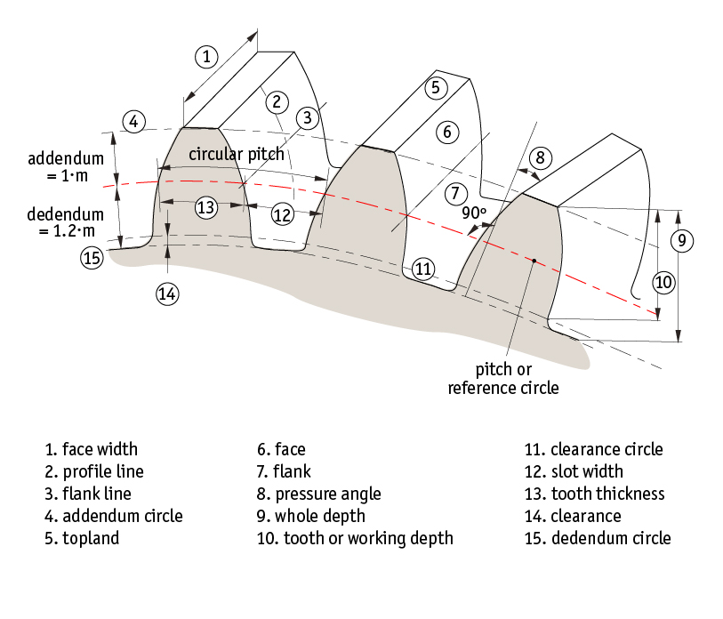

# A8 – Gears

## Objective
- Design a gearbox that can be assembled and disassembled.
  
- Analyze and size input and output shafts for strength.

- Design journal bearings to support shafts.

- Create a gearbox housing with proper clearance and fastening.

- Use parametric CAD modeling to generate a final design.

- Document calculations, sketches, and lessons learned.

## Analyze
####Description
- Design a gearbox which can be assembled and disassembled. The spur gears have a gear ratio of 24:9 and are listed in the resource section. The output gear torque and speed are to be 1.25 in-lbf and 1100 rpm relative. The input (pinion,power-transmission) and output (gear, short shaft) shaft diameters are .125 and .25 inches respectively and each have a length of 1 inch. Use the appropriate equations in the Machinery’s Handbook for empirical units. The critical features of the gearbox include the shafts, and the journal bearings.

- Assumptions: 
Assume appropriate strength of shafts, use Machinery’s Handbook.
The gear train is ideal.
The moment of the radial force from the gear train is small enough to be ignored.

####Design Constraints 
|Component|Input|Output|
|---------|-----|------|
|Gear|Pinion|Gear|
|Gear Ratio|9 teeth|24 teeth|
|Shaft Diameter|0.125 in|0.250 in|
|Shaft Length| 1 in| 1 in|
|Torque| Calculate| 1.25 in-lbf|
|Speed| Calculate| 1100 rpm|

#### Background Knowledge 
<h5 style="font-size: 18px; color: navy;">What is a Gearbox?</h5>

A gearbox is a mechanical system that transfers rotational power from one shaft to another using  gears. The two important components include: 
  1. Pinion: the smaller driving gear connected to the input shaft.
  2. Gear: the larger driven gear connected to the output shaft.

Once the pinion rotates, it's teeth push against the teeth of the larger gear, causing it to rotate in the opposite direction. Gears allow us to change the relationship between rotational speed and torque.

For example: a smaller pinion rotates faster, meanwhile a larger gear rotates slower, however the larger gear produces more torque (speed reduction).

This website contains an interactive animation that presents this phenomena: [Click Here.](https://www.firgelliauto.com/blogs/mechanisms/spur-gears?srsltid=AYCX9vIklASGvxygUrVqilr2I9KkZdLuprjonFHcWoAABqYWqdxKxEUO)

<h5 style="font-size: 18px; color: navy;">GearTerminology</h5>

  

## Decide

## Communicate

